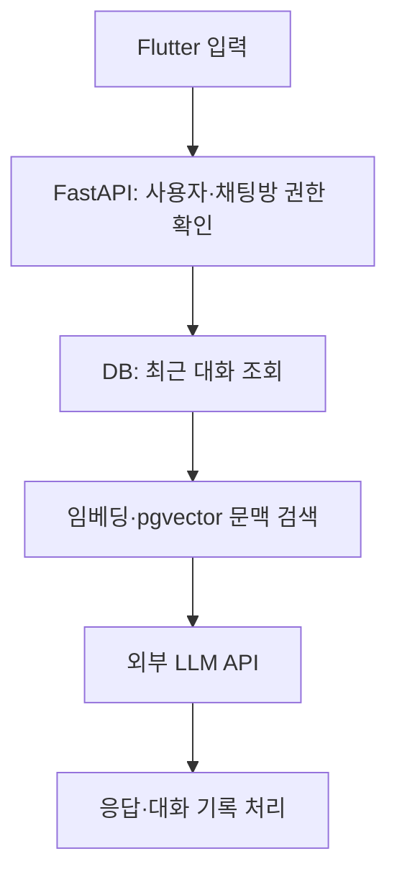

# Sadie · LLM 학습 실험과 대화 앱 백엔드

**LLM 파인튜닝을 시도하고, 별도로 외부 LLM API를 사용하는 대화 앱을 연결한 개인 프로젝트입니다.**

[Flutter 앱](https://github.com/EddieEom/Sadie_frontend) · [대화 API 코드](routes/chat.py) · [실행 방법](#실행-방법)

> 현재 저장소에는 앱 실행 캡처가 없습니다. 아래는 코드에 기반한 처리 구조이며 실행 화면을 대신한 이미지가 아닙니다.

## 담당 범위

| 범위 | 수행 내용 |
| --- | --- |
| 학습 실험 | AI Hub 데이터 전처리, 학습용 형식 구성, LLaMA 3.1 추가 학습 시도 |
| 실험 장비 | A100 GPU 2개가 장착된 학교 서버. 분산 학습 성능을 검증했다는 의미는 아님 |
| 앱·서버 | Flutter 앱과 FastAPI 백엔드의 대화 연동 |
| 현재 모델 호출 | Hugging Face Router의 외부 모델 API |
| 저장소 범위 | 백엔드 코드. 학습 스크립트·체크포인트·평가 로그는 미포함 |

개인 프로젝트의 수행 범위를 적었으며, 코드 작성 도구별 기여율은 별도 기록이 없어 제시하지 않습니다.

## 개발 과정

### 학습을 돌렸는데 답변이 좋아졌는지는 별개였다

LLaMA 3.1의 한국어 응답이 기대에 미치지 못해 AI Hub 데이터를 JSONL로 정리하고 일부 데이터로 추가 학습을 시도했습니다.

학습 실행은 경험했지만 뚜렷한 응답 개선은 확인하지 못했습니다. 데이터 준비와 학습 성공 여부만 볼 것이 아니라, 같은 질문에 대한 전후 응답과 학습 조건을 기록해야 비교할 수 있다는 점을 알게 됐습니다.

### 학습 실험과 앱 개발을 구분하기

현재 앱은 외부 LLM API를 호출합니다. 초기 학습 모델을 배포해 서비스하고 있다고 설명하면 실제 코드와 달라지므로 두 범위를 구분했습니다.

대화 API에서는 사용자·채팅방 권한을 확인하고 최근 메시지를 읽은 뒤, 검색한 문맥과 사용자 입력을 모델 호출에 연결하는 구조를 구성했습니다.

## 코드와 확인 범위



[대화 처리 코드](routes/chat.py) · [사용자·DB 설정](core) · [API 라우트](routes)

개발 당시 앱과 서버를 연결해 대화 동작을 확인했습니다. 검색 결과·응답 품질의 체계적인 평가와 학습 실험의 재현 자료 정리는 남은 과제입니다.

## 실행 방법

<details>
<summary><b>⚙️ 사용 기술 · 환경변수 · 실행</b></summary>

## 사용 기술

Python, FastAPI, PostgreSQL, pgvector, Hugging Face, Flutter, Supabase, Render

## 환경변수

프로젝트 실행을 위해 `.env` 파일에 다음 환경변수가 필요합니다.

```env
DB_URL=
SECRET_KEY=
ALGORITHM=HS256

HF_TOKEN=

GOOGLE_CLIENT_ID=

SUPABASE_URL=
SUPABASE_KEY=

BREVO_API_KEY=
```

> 실제 API Key와 Secret 값은 Repository에 Commit하지 않습니다.

## 실행 방법

### 1. Clone Repository

```bash
git clone https://github.com/EddieEom/Sadie-backend.git
cd Sadie-backend
```

### 2. Create Virtual Environment

#### Windows

```bash
python -m venv venv
venv\Scripts\activate
```

#### macOS / Linux

```bash
python3 -m venv venv
source venv/bin/activate
```

### 3. Install Dependencies

```bash
pip install -r requirements.txt
```

### 4. Environment Configuration

프로젝트 Root에 `.env` 파일을 생성합니다.

```env
DB_URL=YOUR_POSTGRESQL_CONNECTION_STRING
SECRET_KEY=YOUR_JWT_SECRET
ALGORITHM=HS256

HF_TOKEN=YOUR_HUGGINGFACE_TOKEN

GOOGLE_CLIENT_ID=YOUR_GOOGLE_CLIENT_ID

SUPABASE_URL=YOUR_SUPABASE_URL
SUPABASE_KEY=YOUR_SUPABASE_KEY

BREVO_API_KEY=YOUR_BREVO_API_KEY
```

### 5. Run Server

```bash
uvicorn main:app --reload
```

Server:

```text
http://127.0.0.1:8000
```

Swagger:

```text
http://127.0.0.1:8000/docs
```

실행하려면 DB 구조와 외부 서비스 설정을 함께 준비해야 합니다.

</details>


[📱 Flutter 앱 저장소 →](https://github.com/EddieEom/Sadie_frontend)
